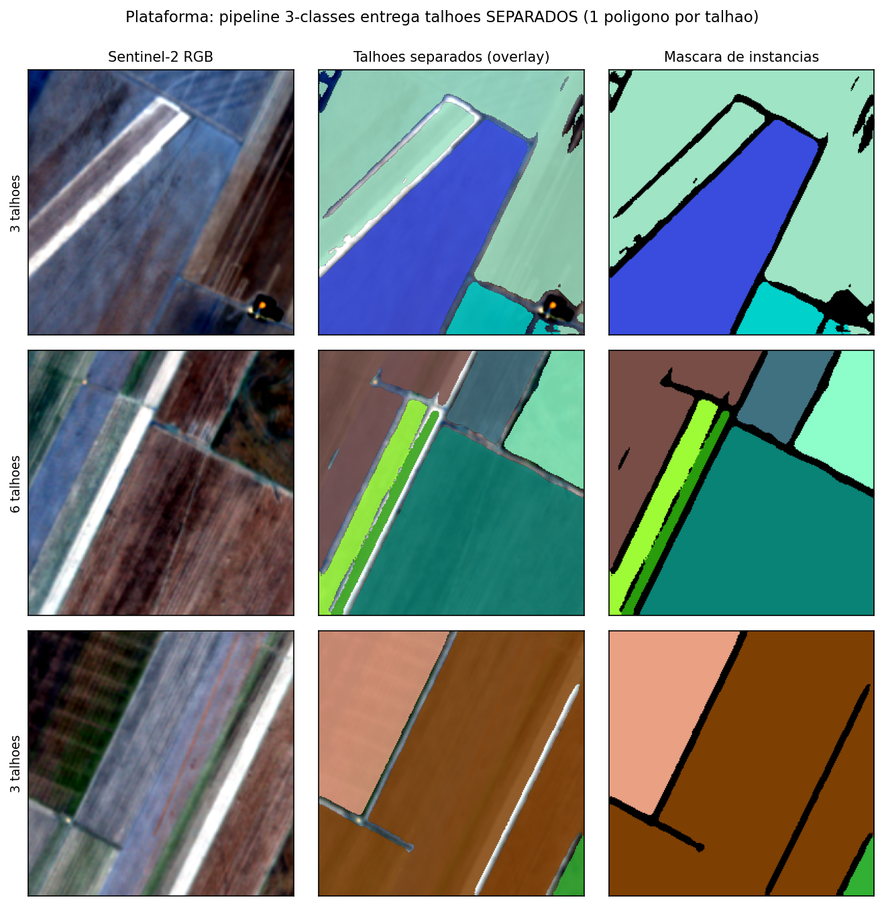
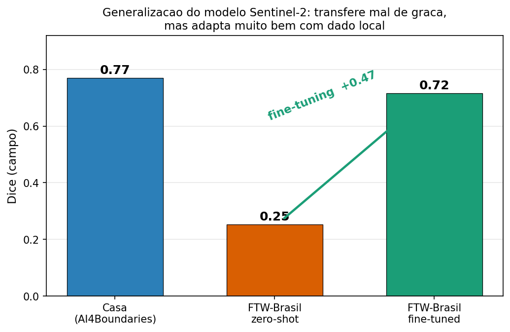

# Detecção de talhões agrícolas com Sentinel-2

Pipeline de deep learning que detecta **talhões agrícolas individuais** em imagens **Sentinel-2 multitemporais** e entrega os polígonos (GeoJSON, com área em hectares).

> Trabalho de Conclusão de Curso — Inteligência Artificial Aplicada, PUCPR (2026).
> *Segmentação Automática de Limites de Talhões Agrícolas com Redes Neurais Profundas e Imagens Sentinel-2 Multitemporais.*



## Resultados

| Avaliação | Métrica | Valor |
|---|---|---|
| Domínio de treino (AI4Boundaries, teste, 1.139 tiles) | Dice médio / mediano | **0,77 / 0,87** |
| | IoU / Precisão / Recall / F1 (médios) | 0,68 / 0,79 / 0,82 / 0,78 |
| Fields of The World – Brasil, sem adaptação (zero-shot) | Dice | ~0,25 |
| Fields of The World – Brasil, após fine-tuning (188 tiles) | Dice / IoU / Precisão / Recall / F1 | **0,72** / 0,67 / 0,72 / 0,90 / 0,80 |
| Objeto — baseline semântico (653 talhões) | F1@IoU≥0,5 / PQ | 0,455 / 0,381 |
| Objeto — borda + separação de instâncias | F1@IoU≥0,5 / PQ | **0,594 / 0,512** (+30%) |

- **Generalização:** o modelo treinado na Europa cai para Dice ~0,25 no Brasil; com fine-tuning usando pouco dado local, volta para 0,72.
- **Instâncias:** uma cabeça de 3 classes (interior, borda, fundo) separa talhões vizinhos que a segmentação semântica fundia.
- **Ponto fraco:** talhões muito pequenos (< 5% do tile), com Dice entre 0,18 e 0,49; grandes e médios ficam entre 0,70 e 0,93.



## Como funciona

1. **Entrada multitemporal:** 6 datas × 5 canais (B2, B3, B4, B8, NDVI) = 30 canais, normalizados por percentil 2–98 por canal.
2. **Ensemble de 6 redes:** U-Net, DeepLabV3+ e U-Net++ com encoders ResNet-34/50 (`segmentation-models-pytorch`), com TTA por flips.
3. **Pós-processamento:** limiar e área mínima calibrados na validação; vetorização em polígonos com Rasterio e Shapely.
4. **Separação de instâncias:** modelo de 3 classes avaliado talhão a talhão (F1 de objeto e Panoptic Quality).
5. **Entrega:** um polígono por talhão, com área em hectares.

## Estrutura

```
scripts/      experimentos numerados (01 → 62): treino, avaliação, ensembles, pós-processamento, figuras
  15_train_unet_sentinel2_baseline.py        treino Sentinel-2 (30 canais)
  21_… / 22_…                                avaliação de ensembles e TTA
  44_predict_sentinel2_fields_end_to_end.py  inferência de ponta a ponta → GeoJSON
  58_… / 59_…                                validação e fine-tuning no Fields of The World – Brasil
  60_… / 61_… / 62_…                         métricas de objeto e modelo de instâncias
  51_… a 56_…                                experimento com RGB de uma data (descartado)
  colab/                                     notebooks para treinar em GPU na nuvem
src/field_boundary/   biblioteca: dataset, modelos, perdas, métricas, poligonização
tools/                ferramenta web (FastAPI + React) para registrar casos de teste manuais
docs/                 resultados detalhados, roteiro de defesa e legendas das figuras
figures/              figuras da tese
```

## Como rodar

```bash
python -m venv .venv
# Windows: .venv\Scripts\activate  ·  Linux/Mac: source .venv/bin/activate
pip install torch torchvision --index-url https://download.pytorch.org/whl/cu126
pip install -r requirements.txt
```

**Dados** (não versionados por causa do tamanho):

- [AI4Boundaries](https://github.com/waldnerf/ai4boundaries) — treino e teste no domínio europeu, em `data/raw/ai4boundaries/sentinel2`.
- [Fields of The World](https://fieldsofthe.world) — recorte Brasil, para validação e fine-tuning.

**Inferência de ponta a ponta** numa cena Sentinel-2 já baixada (`.nc` ou `.tif`):

```bash
python scripts/44_predict_sentinel2_fields_end_to_end.py \
  --input caminho/para/imagens \
  --output-dir outputs/sentinel2/end_to_end_fields \
  --threshold 0.49 --min-area 90 --tta-mode flips
```

Saídas: probabilidade e máscara (`.tif`), polígonos (`.geojson` e `.csv`) e um painel PNG por imagem. Detalhes em [`docs/END_TO_END_SENTINEL2_FIELDS.md`](docs/END_TO_END_SENTINEL2_FIELDS.md).

**Pesos treinados:** os checkpoints (`.pt`) não ficam no repositório (até 560 MB cada). O modelo de separação de instâncias é publicado na aba **Releases**.

## Decisões de engenharia

- **Multitemporal em vez de RGB:** segmentar uma única imagem RGB dependia demais da cena; as 6 datas capturam o ciclo da cultura.
- **Pré-processamento idêntico no treino e na inferência:** uma ordem de bandas errada zerava a predição — o código valida isso.
- **Sem vazamento:** split oficial do FTW; calibração só na validação e métricas finais no teste.
- **Hardware modesto:** treinado numa GTX 1650 (fp32, pois fp16 gerava NaN) e em GPUs gratuitas na nuvem.

## Documentação

- [`docs/RESULTADOS_SENTINEL2.md`](docs/RESULTADOS_SENTINEL2.md) — resultados detalhados
- [`docs/DEFESA_ROTEIRO.md`](docs/DEFESA_ROTEIRO.md) — roteiro da defesa e perguntas da banca
- [`docs/REVISAO_DEEP_LEARNING.md`](docs/REVISAO_DEEP_LEARNING.md) — revisão técnica do deep learning
- [`docs/LEGENDAS_FIGURAS.md`](docs/LEGENDAS_FIGURAS.md) — legendas das figuras

## Autor

**Yuri Shiroiva** — [portfólio](https://yurishiroiva.github.io) · [GitHub](https://github.com/YuriShiroiva)
